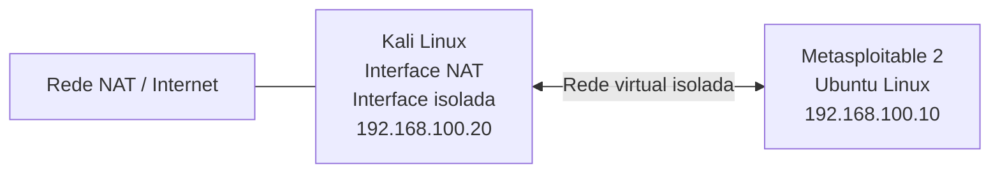

# 🧪 Metasploitable 2 — Ambiente de Treinamento

<p align="center">
  
  
  
</p>

<p align="center">
  <strong>Ambiente virtualizado de treinamento utilizado para estudar serviços de rede, identificar vulnerabilidades e executar testes controlados de segurança.</strong>
</p>

---

## 📖 Visão Geral

O **Metasploitable 2** é uma máquina virtual baseada em Ubuntu Linux, desenvolvida pela Rapid7 com o propósito de fornecer um ambiente intencionalmente vulnerável para treinamento em segurança da informação.

Diferentemente de um sistema operacional convencional, a máquina contém serviços, aplicações e configurações com diferentes fragilidades de segurança. Essas características permitem estudar superfícies de ataque, praticar reconhecimento e enumeração, investigar vulnerabilidades e testar ferramentas de segurança em um ambiente controlado.

O Metasploitable 2 é amplamente utilizado em atividades de treinamento e experimentação com ferramentas de *Penetration Testing*.

Neste projeto, a máquina é utilizada como sistema alvo (*Target Environment*) para investigações práticas, permitindo observar o comportamento de serviços vulneráveis e analisar os resultados obtidos durante os testes.

## 🎯 Objetivos do Laboratório

O ambiente foi configurado para desenvolver conhecimentos práticos em diferentes etapas de uma investigação de segurança:

- 🔎 **Reconnaissance:** identificação do alvo e coleta inicial de informações.
- 🌐 **Service Enumeration:** descoberta e análise dos serviços de rede disponíveis.
- 🔐 **Authentication Security:** investigação de mecanismos de autenticação e exposição de credenciais.
- 💥 **Vulnerability Assessment:** identificação, pesquisa e validação de vulnerabilidades.
- ⚔️ **Controlled Exploitation:** reprodução de vulnerabilidades em ambiente autorizado.
- 📡 **Traffic Analysis:** captura e interpretação de tráfego de rede.
- 🛡️ **Security Analysis:** avaliação dos impactos e estudo de medidas de mitigação.

## ⚙️ Características do Ambiente

| Componente | Descrição |
|---|---|
| Máquina alvo | Metasploitable 2 |
| Sistema operacional | Ubuntu Linux |
| Finalidade | Treinamento e testes de segurança |
| Tipo de sistema | Máquina virtual intencionalmente vulnerável |
| Virtualização utilizada | QEMU/KVM por meio do virt-manager |
| Máquina de testes | Kali Linux |
| Rede do laboratório | Rede virtual isolada |
| Estado da máquina | Snapshot externo disponível para recuperação do ambiente |

### Configuração de Rede

O laboratório utiliza uma rede virtual isolada para permitir a comunicação entre a máquina de testes e o sistema alvo sem expor o Metasploitable 2 diretamente à internet.

A máquina Kali Linux possui duas interfaces de rede:

- **Interface NAT:** utilizada para conectividade externa quando necessário.
- **Interface isolada:** utilizada para comunicação com as máquinas do laboratório.

O Metasploitable 2 permanece conectado exclusivamente à rede isolada.

**Endereços utilizados nas investigações atuais:**

| Máquina | Endereço IP |
|---|---|
| Kali Linux — interface do laboratório | `192.168.100.20` |
| Metasploitable 2 — alvo | `192.168.100.10` |

Os endereços são referências do ambiente atual e podem precisar ser configurados ou verificados novamente após a inicialização das máquinas virtuais.

### Topologia do Laboratório



Essa configuração permite que a máquina Kali Linux seja utilizada como estação de análise e testes, enquanto o Metasploitable 2 permanece protegido de conexões externas diretas.

## 🔍 Escopo das Investigações

As atividades realizadas neste ambiente concentram-se inicialmente na análise de serviços de rede e suas respectivas superfícies de ataque.

O primeiro serviço investigado é o **FTP**, incluindo aspectos relacionados à autenticação, exposição de informações e vulnerabilidades associadas ao servidor `vsftpd`.

A documentação desse serviço está organizada em um diretório próprio, que reúne sua contextualização técnica e os relatórios das investigações realizadas.

📂 [Acessar a documentação do serviço FTP](ftp/README.md)

## 📂 Organização da Documentação

A documentação do ambiente segue uma estrutura hierárquica, separando a apresentação da máquina, o contexto dos serviços e os relatórios específicos de cada investigação.

```text
metasploitable-2/
├── README.md
└── ftp/
    ├── README.md
    ├── authentication-security/
    │   ├── README.md
    │   ├── evidence/
    │   └── references/
    └── vsftpd-234-backdoor/
        ├── README.md
        ├── evidence/
        └── references/
```

Cada diretório possui uma finalidade específica:

- **README.md:** apresentação geral do ambiente ou serviço.
- **authentication-security/:** investigação dos mecanismos de autenticação FTP.
- **vsftpd-234-backdoor/:** análise da vulnerabilidade associada à CVE-2011-2523.
- **evidence/:** armazenamento das evidências visuais coletadas durante as atividades.
- **references/:** documentação oficial e fontes técnicas utilizadas nas investigações.

## ⚠️ Segurança do Ambiente

O Metasploitable 2 foi desenvolvido propositalmente com vulnerabilidades e não deve ser tratado como um sistema operacional seguro para uso cotidiano ou produção.

Para evitar exposição indevida:

- Manter a máquina conectada exclusivamente a uma rede virtual isolada.
- Não utilizar adaptador de rede em modo *Bridged*.
- Não expor serviços do Metasploitable 2 diretamente à internet.
- Executar testes somente dentro do ambiente autorizado.
- Utilizar snapshots para permitir a recuperação de estados conhecidos da máquina.

A própria documentação de distribuição do Metasploitable recomenda não expor a máquina a redes não confiáveis.

## 📚 Referências

- [Rapid7 — Metasploitable 2 Documentation](https://docs.rapid7.com/metasploit/metasploitable-2/)
- [Rapid7 — Introducing Metasploitable 2](https://www.rapid7.com/blog/post/2012/06/13/introducing-metasploitable-2/)
- [SourceForge — Metasploitable 2](https://sourceforge.net/projects/metasploitable/files/Metasploitable2/)

---

<p align="center">
  <strong>🔎 Reconhecer. 🔬 Investigar. ⚔️ Validar. 🛡️ Compreender.</strong>
</p>

<p align="center">
  <sub>Cybersecurity Training Labs · Metasploitable 2</sub>
</p>
