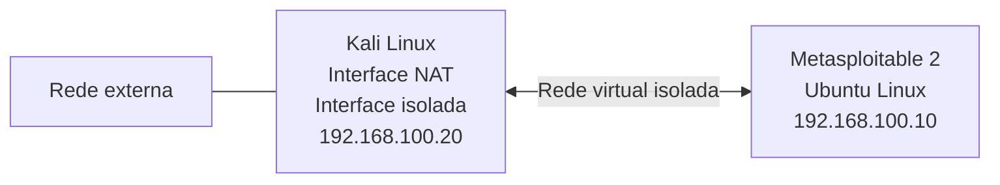

# 🎯 Metasploitable 2 — Ambiente de Treinamento

<p align="center">
  
  
  
</p>

<p align="center">
  <strong>Ambiente virtualizado de treinamento utilizado para investigação de vulnerabilidades, análise de serviços de rede e práticas de segurança ofensiva.</strong>
</p>

---

## 📖 1. Visão geral

O **Metasploitable 2** é uma máquina virtual baseada em Ubuntu Linux, desenvolvida pela Rapid7 com o propósito de fornecer um ambiente intencionalmente vulnerável para treinamento em segurança da informação.

Diferentemente de um sistema operacional convencional, essa máquina contém serviços, aplicações e configurações com diferentes fragilidades de segurança. Essas características permitem estudar superfícies de ataque (*Attack Surface*), praticar reconhecimento e enumeração, investigar vulnerabilidades e testar ferramentas de segurança em um ambiente controlado.

O Metasploitable 2 foi desenvolvido para atividades educacionais, pesquisa em segurança e prática de técnicas de *Penetration Testing*.

Neste projeto, a máquina é utilizada como sistema alvo (*Target Environment*) para investigações práticas, permitindo analisar o comportamento de serviços vulneráveis, validar descobertas e compreender os impactos de diferentes falhas de segurança.

## 🎯 2. Objetivos do laboratório

O ambiente é utilizado para desenvolver conhecimentos práticos em diferentes etapas de uma investigação de segurança:

- 🔎 **Reconnaissance:** identificação do alvo e coleta inicial de informações.
- 🌐 **Service Enumeration:** descoberta e análise dos serviços de rede disponíveis.
- 🔐 **Authentication Security:** investigação de mecanismos de autenticação e exposição de credenciais.
- 💥 **Vulnerability Assessment:** identificação, pesquisa e validação de vulnerabilidades.
- ⚔️ **Controlled Exploitation:** reprodução de vulnerabilidades em ambiente autorizado.
- 📡 **Traffic Analysis:** captura e interpretação de tráfego de rede.
- 🛡️ **Security Analysis:** avaliação dos impactos e estudo de medidas de mitigação.

## ⚙️ 3. Características do sistema

| Componente | Especificação |
|---|---|
| Máquina virtual | Metasploitable 2 |
| Desenvolvedor | Rapid7 |
| Sistema operacional | Ubuntu Linux 8.04 |
| Kernel identificado | Linux 2.6.24-16-server |
| Arquitetura | x86 (i686) |
| Finalidade | Treinamento e testes de segurança |
| Tipo de ambiente | Máquina intencionalmente vulnerável |
| Virtualização | QEMU/KVM |
| Gerenciador de máquinas virtuais | virt-manager |

As informações do sistema operacional e da arquitetura foram obtidas durante a investigação por meio do comando `sysinfo`, utilizando uma sessão Meterpreter.

### 💻 Ambiente de virtualização

A máquina está sendo executada em ambiente virtualizado utilizando QEMU/KVM, com gerenciamento pelo virt-manager.

Essa configuração permite controlar a conectividade da máquina, realizar snapshots e recuperar estados anteriores do ambiente durante os experimentos.

Um snapshot externo foi configurado para possibilitar a recuperação da máquina a um estado conhecido.

## 🌐 4. Configuração de rede

O laboratório utiliza uma rede virtual isolada para permitir a comunicação entre a máquina de análise e o sistema alvo, sem expor diretamente o Metasploitable 2 à internet.

A máquina Kali Linux possui duas interfaces de rede:

- **Interface NAT:** utilizada para conectividade externa quando necessário.
- **Interface isolada:** utilizada exclusivamente para comunicação com as máquinas do laboratório.

O Metasploitable 2 permanece conectado à rede isolada.

### Endereçamento IP

| Máquina | Função | Endereço IP |
|---|---|---|
| Kali Linux | Máquina de análise | `192.168.100.20` |
| Metasploitable 2 | Sistema alvo | `192.168.100.10` |

### Interface de rede do alvo

| Campo | Valor |
|---|---|
| Interface | `eth0` |
| Endereço IPv4 | `192.168.100.10/24` |
| Endereço MAC | `52:54:00:85:3a:6a` |

**Observação:** o endereço IP apresentado representa a configuração utilizada nas investigações atuais. A configuração de rede pode precisar ser verificada ou refeita após a inicialização da máquina virtual.

### 🗺️ Topologia do laboratório



A topologia permite que a máquina Kali Linux funcione como estação de análise e testes, enquanto o Metasploitable 2 permanece restrito à rede virtual do laboratório.

## 🔍 5. Escopo de investigação

As investigações neste ambiente concentram-se inicialmente na identificação, análise e validação de vulnerabilidades presentes nos serviços disponibilizados pela máquina.

O primeiro serviço investigado é o **FTP**, incluindo aspectos relacionados à autenticação, exposição de credenciais e vulnerabilidades associadas ao servidor `vsftpd`.

A documentação dos serviços e das respectivas investigações é mantida em diretórios independentes, permitindo separar o contexto técnico dos relatórios de exploração.

📂 **[Acessar documentação do serviço FTP](ftp/README.md)**

Novos serviços e superfícies de ataque poderão ser incorporados ao ambiente conforme o avanço dos estudos.

## 📂 6. Organização da documentação

A documentação segue uma estrutura hierárquica, separando a apresentação da máquina, o contexto de cada serviço e os relatórios específicos das investigações.

```text
metasploitable-2/
├── README.md
└── ftp/
    ├── README.md
    ├── authentication-security/
    │   ├── README.md
    │   ├── evidence/
    │   └── references/
    └── vsftpd-234-backdoor/
        ├── README.md
        ├── evidence/
        └── references/
```

Cada diretório possui uma finalidade específica:

- **README.md:** apresentação geral do ambiente, serviço ou investigação.
- **evidence/:** armazenamento de capturas de tela e evidências técnicas.
- **references/:** documentação oficial e fontes utilizadas durante as pesquisas.

Essa organização permite que cada investigação tenha sua própria metodologia, análise, resultados e referências, sem concentrar toda a documentação em um único arquivo.

## ⚠️ 7. Segurança e isolamento

O Metasploitable 2 foi desenvolvido propositalmente com vulnerabilidades e não deve ser utilizado como sistema operacional convencional ou em ambiente de produção.

Para evitar exposição indevida:

- Manter a máquina conectada exclusivamente à rede virtual isolada do laboratório.
- Não utilizar adaptador de rede em modo *Bridged*.
- Não expor serviços do Metasploitable 2 diretamente à internet.
- Realizar testes somente em ambientes autorizados.
- Utilizar snapshots para possibilitar a recuperação de estados conhecidos da máquina.

A documentação oficial da Rapid7 também recomenda que o Metasploitable 2 não seja exposto a redes não confiáveis.

## 📚 8. Referências

- [Rapid7 — Metasploitable 2 Documentation](https://docs.rapid7.com/metasploit/metasploitable-2/)
- [Rapid7 — Setting Up a Vulnerable Target](https://help.metasploit.com/Content/getting-started/setting-up-test-env.html)
- [SourceForge — Metasploitable 2](https://sourceforge.net/projects/metasploitable/files/Metasploitable2/)

---

<p align="center">
  <strong>🔎 Reconhecer. 🔬 Investigar. ⚔️ Validar. 🛡️ Compreender.</strong>
</p>

<p align="center">
  <sub>Metasploitable 2 · Cybersecurity Training Environment</sub>
</p>
